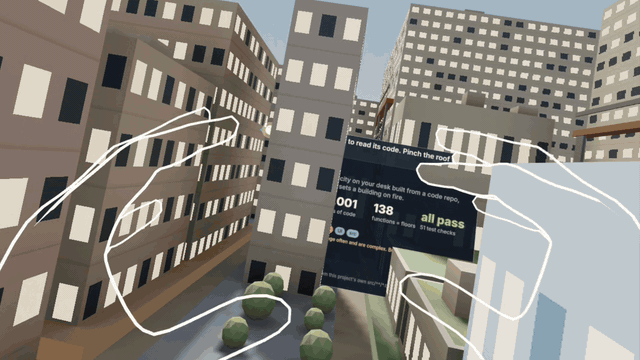
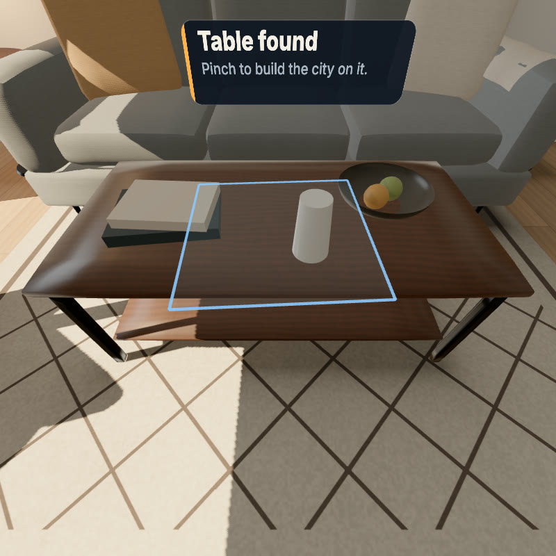
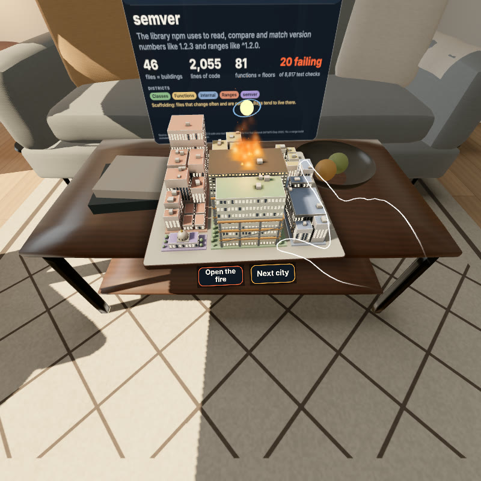
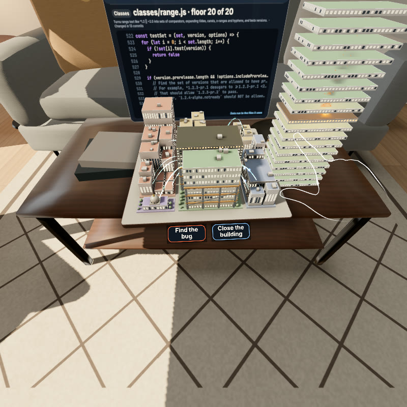
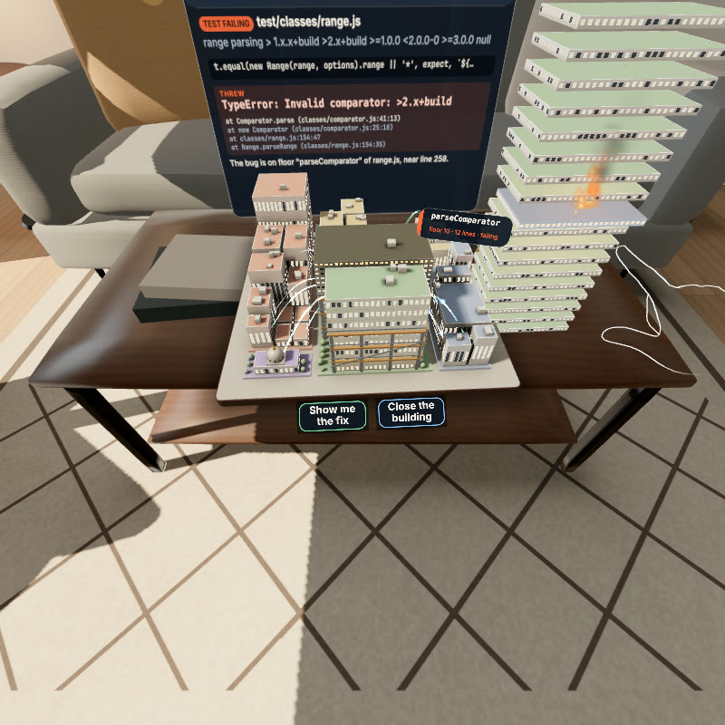
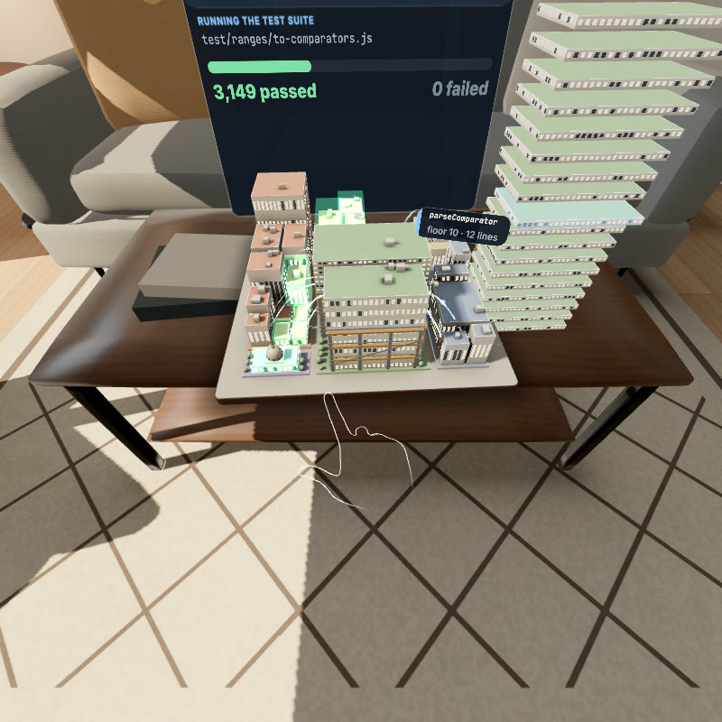
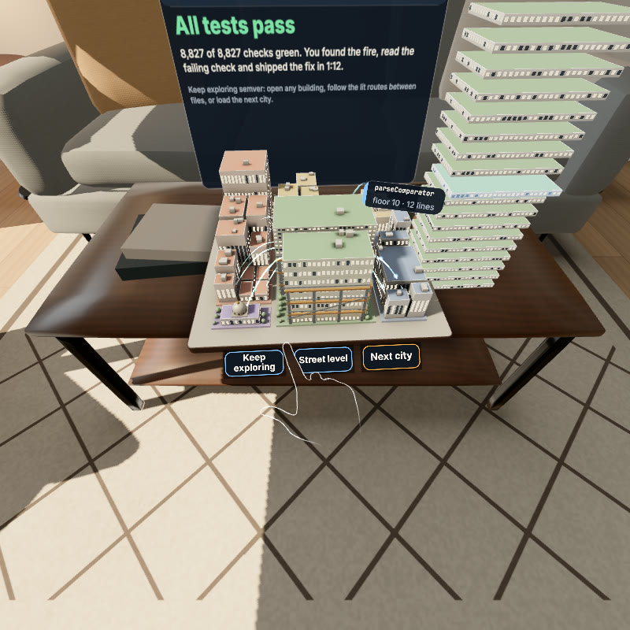
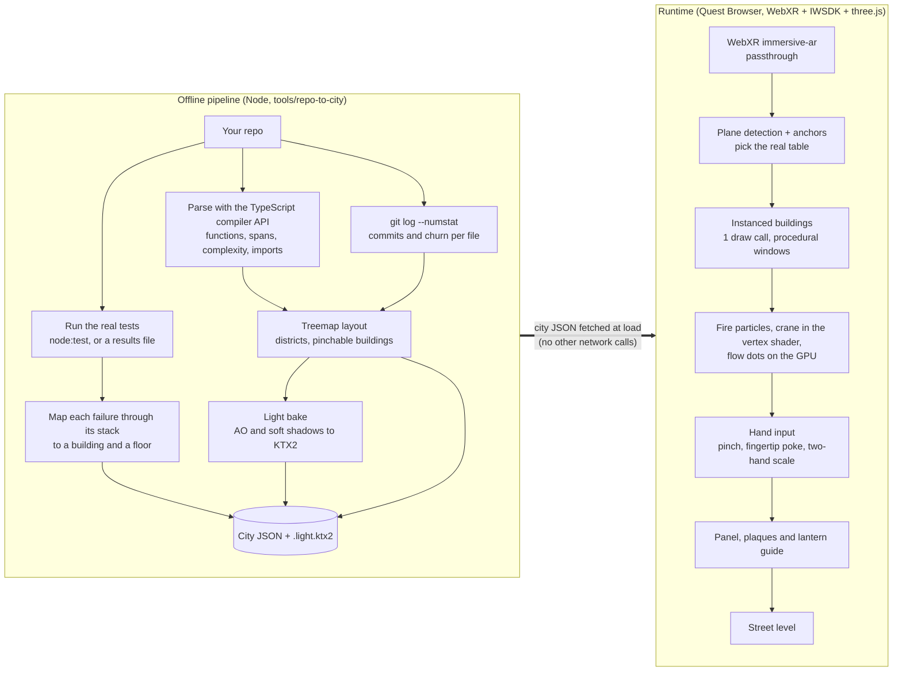

<p align="center">
  
</p>

<h1 align="center">Repo City</h1>

<p align="center"><b>Your code repository as a miniature city on your real desk. A failing test is a building on fire.</b><br>
Hands-only mixed reality for Meta Quest 3, in the browser (WebXR + Meta's Immersive Web SDK).</p>

<p align="center">
  <a href="LICENSE"></a>
  <a href="https://github.com/saurabh4269/repo-city/actions/workflows/ci.yml"></a>
  
  
  
  
</p>

<p align="center"><i>The GIF above is a real Quest 3 capture at street level (no passthrough in this mode).</i></p>

## Try it

- **Live demo:** https://repo-city-phi.vercel.app (open it in Meta Quest Browser)
- **Demo video:** coming soon

Open the live demo in **Quest Browser** on a Meta Quest 3 or 3S, press **Enter XR**, put the controllers down and use your hands. On a desktop browser the page shows what it is; the XR session needs a headset.

## Why

More and more of my code is now written by a coding agent. I describe the change, the agent works for a few minutes, and I wait. The code still gets written, but I lose my picture of the project: I know the file names, not the shape. Which file is the front door, which parts are tangled together, where things keep breaking.

A file tree doesn't give you that. A place does. So: you're vibecoding and waiting on your agent. Put on the headset, and your own repo is a city standing on the desk you're already working at. Your laptop and coffee stay in view through passthrough. You lift a roof off with a pinch, touch the floor that's burning, and see the exact function and assertion that's failing.

## The mapping

| In your repo | In the city |
|---|---|
| A file | A building. Footprint grows with lines of code, height with complexity |
| A folder | A district, with its own tint |
| An import | A street. Routes light up between buildings when you open one, with dots flowing toward the files it uses |
| A function | A floor. Lift the roof and the building slides out onto your desk as a stack of floors |
| A failing test | A fire, on the building and floor where the failure's stack trace lands |
| The entry file (`package.json` exports or main, else `index.*`) | The town hall, a domed civic building the guide shows you first |
| A hot spot (changed often in git history **and** complex) | Scaffolding, with the facade worn toward the base |

## The journey

The guided journey takes 2 to 4 minutes, seated, hands only. A small lantern guide explains each step out loud and in captions, and every step also has a plaque lying on the table, so you can always continue by touch.

| | |
|---|---|
|  |  |
| **1. Place it.** Quest's room data finds your table. Pinch to build the city there. No table detected? Hold a hand over a surface, or use a virtual desk. | **2. The city rises.** The guide starts at the town hall, then flies to the building on fire. The panel shows 46 files, 2,055 lines, 81 functions and 20 failing checks. |
|  | 2.x+build, with the real stack"> |
| **3. Lift the roof.** Pinch the burning roof and lift. The building slides out beside the city as one floor per function. | **4. Touch the fire.** Touch the smouldering floor with a fingertip. The panel shows the real assertion, the error and the stack. |
|  |  |
| **5. Fix it and run the tests.** A tower crane lifts the broken floor out and lowers the fixed one in, then the test run sweeps the city green. | **6. All tests pass.** 8,827 of 8,827. Keep exploring, open the next city, or go to **street level**. |

Screenshots 1 to 6 are from Meta's IWER emulator (the same build, driven by the end-to-end test). The GIF at the top is the real headset.

**The bug is real.** The bundled city is [semver](https://github.com/npm/node-semver) 7.7.3, the version library npm uses (ISC licence). Upstream commit [`2471d75`](https://github.com/npm/node-semver/commit/2471d7543e2e63d9d95358e2405e7e1cde926c36) ("fix: x-range build metadata support", September 2025) added one line to `parseComparator` in `classes/range.js`. We removed that line from our snapshot. Semver's own test suite then fails 20 assertions with `TypeError: Invalid comparator: >2.x+build`, the fire panel shows that error with its real stack, the fix panel shows the upstream commit, and after the crane 8,827 of 8,827 assertions pass. See [`fixtures/semver/REPO-CITY-NOTE.md`](fixtures/semver/REPO-CITY-NOTE.md).

A second city is Repo City's own source code.

**Also in the headset:**
- **Two-hand pinch** above the city scales and turns it.
- **Street level:** poke the plaque and the city grows about 8 times past your table to a hazy horizon. Pinch and drag with one hand to move through it, two-hand pinch to scale, **Back to the desk** to return.
- **Pass the headset on:** the panel, plaques and opened building turn to face whoever is wearing the headset now, and re-snap after a Quest recenter.

## Use it on your own repo

```bash
npm run city:repo -- /path/to/your/repo
# then open https://<this machine>:8083/?city=./cities/<repo-name>.json in Quest Browser
```

What it does, on your machine, with nothing uploaded:

1. Finds the source folder (`src/`, else `lib/`, else the repo root). `--include src,lib` overrides it.
2. Parses every JS and TS file with the TypeScript compiler API: functions with their line spans and a complexity measure, and the import graph.
3. Runs your tests with Node's built-in test runner (`node:test`): `.js`, `.mjs` and `.ts` files under `test/`, `tests/`, `__tests__/`, or named `*.test.*` / `*.spec.*`. TypeScript tests need Node 22.18 or newer.
4. Maps each real failure through its stack trace to the building and floor (function) where it breaks, with paths relative to your repo. Test-file naming conventions are the fallback when a stack has no frame in your source.
5. Reads your git history (2 years, at most 2,000 commits, renames followed) for the hot spots, lays the city out, bakes its light, and writes `public/cities/<repo-name>.json` plus a `.light.ktx2` (or `.png` if KTX-Software's `ktx` is not installed).

**Supported today:** JavaScript and TypeScript, `node:test`. **Other runners** (jest, vitest, mocha, tap): run them yourself and pass `--tests results.json` (format in [`tools/repo-to-city/run-tests.mjs`](tools/repo-to-city/run-tests.mjs)). For your own repo there is no crane yet: the guide sends you to your editor or your agent, and you rebuild the city after the fix.

Options: `--name "My app"`, `--id my-app`, `--include src`, `--tests results.json`. The lower-level CLI is `node tools/repo-to-city/index.mjs --root ../my-repo --include src --out public/cities/mine.json` with `--history git|h.json`, `--layout size|affinity` and `--no-light`.

## Architecture



Everything runs on the headset. There is no LLM and no network call at runtime: the guide's lines are prepared from the repo at build time and spoken with the browser's speech synthesis. Sounds are synthesised with Web Audio.

Module map and design decisions: [docs/ARCHITECTURE.md](docs/ARCHITECTURE.md) and [docs/JUDGING.md](docs/JUDGING.md).

## Results on a real Quest 3

About 10 minutes of play on a Quest 3 in Quest Browser 156, 303 samples logged over Wi-Fi by a small dev relay we wrote ([`tools/quest-debug.mjs`](tools/quest-debug.mjs): in dev builds only, the page forwards fps, frame-time p95, long frames and draw calls every 2 s to the dev server):

- **A steady 72 fps**, with **20 to 40 draw calls** per frame. Street level also holds 72 fps.
- Hands were detected immediately, and two-hand scaling worked on both cities.
- First-load hitches (shaders compiling and textures uploading on first draw) reached 0.8 s. Prewarming everything while you are still choosing where to place the city cut the worst frame to 0.12 to 0.18 s, measured on the headset. Smaller, not gone yet.
- The test run first dipped to 66 to 69 fps (a large panel being redrawn several times a second). Its moving parts now sit on a small separate card. That change is not yet re-measured on the headset.

Per-step numbers, the emulator rendering budget and the headset checklist: [docs/TESTING.md](docs/TESTING.md).

## Testing

| Layer | Command | Result |
|---|---|---|
| Unit tests (layout, affinity layout, parser, entry point, git history and hotspot score, city contract, light bake, room placement incl. Quest 3 downward table normals, `city:repo` end to end on a generated repo) | `npm run test:unit` | **51 / 51 pass** |
| Semver's real suite, bug put back / upstream fix restored | `npm run city` | **20 failing** / **8,827 of 8,827 pass** |
| Hands-only journey in Meta's IWER emulator: place, open the fire, read the bug, crane, tests, two-hand scale, a viewer in another seat, street level, next city | `npm run test:xr` | **23 / 23 checks** with the right hand and **23 / 23** with the left hand (pinch-and-lift drag, 5 mm jitter), re-run on this repo on 19 Nov 2026 |
| Typecheck and production build | `npm run typecheck && npm run build` | pass, also in [CI](.github/workflows/ci.yml) |

The emulator test needs a managed browser and the IWSDK dev server, so CI runs the unit tests, typecheck and build only:

```bash
npx @iwsdk/cli dev up --ai-mode agent --allow-browser-automation
npm run test:xr                                   # right hand
npm run test:xr -- --hand left --drag --jitter 5  # left hand, pinch and lift
npm run test:xr:tour                              # same, with a screenshot at each first-of-its-kind moment
```

## Getting started

Requirements: Node 22.18+ or 24 LTS (see `.nvmrc`), git. Optional: [KTX-Software](https://github.com/KhronosGroup/KTX-Software) for KTX2 light bakes (PNG otherwise), Python 3 for the emulator test.

```bash
git clone https://github.com/saurabh4269/repo-city.git
cd repo-city
npm ci
npm run dev          # IWSDK dev server (HTTPS) + emulator at https://localhost:8083
```

`PORT=9000 npm run dev` picks another port.

**On a Quest 3 / 3S:** put the headset on the same Wi-Fi as your computer, open `https://<your-computer's-LAN-IP>:8083` in Quest Browser (`npx @iwsdk/cli dev status` prints it), accept the local certificate warning (Quest Browser needs HTTPS for WebXR), press **Enter XR** and put the controllers down.

**Controls (hands only):**

| Gesture | Does |
|---|---|
| Pinch while looking at your table | Place the city |
| Pinch a roof and lift (or a quick pinch) | Open the building as floors |
| Touch a floor with your fingertip | Read its code, or the failing check |
| Poke a plaque on the table | The next step (Show me the fix, Run the tests, Street level, Next city) |
| Two-hand pinch | Scale and turn the city |
| One-hand pinch and drag (street level) | Move through the city |

**Build your own city:** `npm run city:repo -- /path/to/repo` (above). `npm run city` regenerates the two bundled cities, re-running semver's real suite with the bug and with the fix.

```bash
npm run typecheck
npm run test:unit
npm run build        # static site in dist/, deployable to any HTTPS static host
```

## Project structure

```
src/
  director.ts            the one system: phases page > placing > rising > city > testing > done, guide, plaques, hands to city
  city/                  plinth, districts, instanced buildings, opened building, routes, materials, light layout, city JSON types
  fx/                    fire and smoke particles, the fix crane, flow dots, sparks
  input/hands.ts         pinch with hysteresis, tracking-loss grace, controller fallback
  mr/                    table detection from Quest plane data (pure, unit-tested)
  ui/                    canvas text cards, the main panel, table plaques
tools/
  repo-to-city/          repo > city JSON: parser, layout, history, test runner, light bake, city:repo
  test/                  Node unit tests (node:test)
  e2e/                   hands-only emulator journey (Python, IWSDK CLI)
  quest-debug.mjs        dev-only Wi-Fi relay for headset logs and frame timing
  textures/              generated KTX2 shadow masks
public/cities/           the bundled city JSONs and their baked light (KTX2)
fixtures/                semver 7.7.3 snapshot (ISC) with the real bug put back, test results, git history
docs/                    architecture, design decisions, testing, city-life spec, media
```

## Roadmap

Working now: the semver city and Repo City's own city, the full guided journey, street level, and `city:repo` for your own JS or TS repo with `node:test` (other runners via a results file).

Planned:
- **Agent fix suggestions as worker characters:** your coding agent's proposed fix arrives as workers on the burning building. Cut from the competition build for time.
- **Open a repo from inside the headset** instead of a command and a link.
- **Test with developers on their own repos**, to learn whether a city on the desk helps them understand a codebase their agent is changing, and which parts (fires, hot spots, streets) they actually use.
- Remove the last first-use hitch and re-measure the test run on the headset.

## Prior art and credits

- **Code cities** are an old idea: [CodeCity](https://wettel.github.io/codecity.html) (Richard Wettel) and [CodeCharta](https://github.com/MaibornWolff/codecharta).
- The city-life features (town hall, fix crane, weathering from git history, flow dots, districts placed by coupling) were inspired by **[Claude Clan](https://github.com/mittal-parth/claude-clan)** by Parth Mittal, a desktop isometric code city. It has no licence, so we took ideas only: no code, art or text.
- **[semver](https://github.com/npm/node-semver)** 7.7.3 (ISC, Copyright Isaac Z. Schlueter and Contributors): the bundled city and its test suite, in `fixtures/semver/` with its licence. One line removed, see [REPO-CITY-NOTE.md](fixtures/semver/REPO-CITY-NOTE.md).
- **[Immersive Web SDK](https://github.com/facebook/immersive-web-sdk)** and **three.js** (MIT), **@pmndrs/uikit** (MIT).
- **Basis Universal** transcoder (Apache-2.0), served from IWSDK's vendored copy; textures encoded at build time with **KTX-Software** (Apache-2.0).
- **Fonts:** Inter and JetBrains Mono (SIL Open Font License), loaded from Google Fonts with system fallbacks.
- All geometry, textures, particles and sounds are generated in code. Asset notes: [public/cities/CREDITS.md](public/cities/CREDITS.md), [public/textures/CREDITS.md](public/textures/CREDITS.md).

## Built for

The **Meta VR Start Developer Competition 2026**, Productivity track, New Experience division.

## License

[MIT](LICENSE) for Repo City. The semver snapshot in `fixtures/semver/` keeps its own [ISC licence](fixtures/semver/LICENSE).
