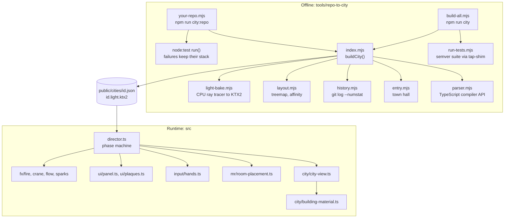

# Architecture

Repo City has two halves that meet at one file format, the **city JSON** (contract: [`src/city/types.ts`](../src/city/types.ts)).

1. **Offline pipeline** (Node, `tools/repo-to-city/`): reads a repository, runs its tests, and writes `public/cities/<id>.json` plus a baked light texture. All analysis happens here, on your machine.
2. **Runtime** (Quest Browser, `src/`): a WebXR `immersive-ar` app built on Meta's Immersive Web SDK (IWSDK 1.1.0) and three.js. It loads a city JSON and makes no other network calls.

## Offline pipeline

| Module | What it does |
|---|---|
| `tools/repo-to-city/your-repo.mjs` | `npm run city:repo -- <path>`: finds the source folder and tests, runs the tests with `node:test`, maps failures through their stacks, then calls `buildCity` with git history and the affinity layout |
| `tools/repo-to-city/index.mjs` | `buildCity()`: parse, entry point, history, layout and test results into one `CityData` object. Also a CLI (`--root --include --out --tests --history --layout --no-light`) |
| `tools/repo-to-city/parser.mjs` | One JS/TS file through the TypeScript compiler API: named functions and methods with line spans, a cyclomatic-complexity proxy, import specifiers |
| `tools/repo-to-city/entry.mjs` | The town hall: `package.json` `exports["."]`, then `main`, then `index.*` |
| `tools/repo-to-city/history.mjs` | `git log --no-merges --numstat` (renames followed): commits and churn per file, and the hotspot score (change frequency times complexity) that drives scaffolding |
| `tools/repo-to-city/layout.mjs` | Squarified treemap for districts and buildings, with a minimum pinchable footprint; the optional affinity layout puts districts that import each other side by side and is kept only if it cuts the coupling cost by at least 10% |
| `tools/repo-to-city/run-tests.mjs` | Runs a repo's tap tests (semver) under `tap-shim/` and normalises the results (total, passed, failed, each failure with its stack) |
| `tools/repo-to-city/build-all.mjs` | `npm run city`: semver's real suite twice (bug put back, then upstream fix restored on a temp copy), then both bundled cities |
| `tools/repo-to-city/light-bake.mjs` | Ambient occlusion and soft sun visibility for every building, prop and the ground into one 512 x 512 atlas (layout shared with the app in `src/city/light-layout.ts`), encoded as KTX2 (UASTC) when `ktx` is installed |
| `tools/textures/make-textures.mjs` | The two generated KTX2 shadow masks in `public/textures/` |

## Runtime

| Module | What it does |
|---|---|
| `src/index.ts` | Creates the IWSDK `World` from `iwsdk.config.json` (AR session, hand tracking, plane detection, anchors) and registers the director |
| `src/director.ts` | The one system. Phases `page > placing > rising > city > testing > done`, the guided steps, the lantern guide, hands to city interaction, street level, facing whoever wears the headset |
| `src/page.ts` | The 2D page outside XR, with an Enter button only when the browser can run immersive AR |
| `src/mr/room-placement.ts`, `src/mr/plane-source.ts` | Picks the real table among detected planes (pure and unit-tested, handles Quest 3's downward table normals), with hand placement and a virtual desk as fallbacks |
| `src/city/city-view.ts` | Plinth, district plates, all buildings as one `InstancedMesh`, the opened building as floors with a liftable roof, import routes, the town hall dome, scaffolding |
| `src/city/building-material.ts` | `MeshStandardMaterial` extended with procedural windows, floor slabs, the baked light atlas, weathering and the fire glow |
| `src/city/details.ts` | Rooftop plant and trees, deterministic from the layout, shared with the light bake so shadows match |
| `src/city/environment.ts`, `src/city/textures.ts` | A small city-matched reflection environment; KTX2 loading with the Basis transcoder served from this origin |
| `src/fx/fire.ts` | Flames, embers and smoke as point sprites (two draw calls, no allocation per frame) |
| `src/fx/crane.ts` | The fix crane: one merged geometry, cable and hook animated in the vertex shader |
| `src/fx/flow.ts` | Dots flowing along an open building's import routes, positioned entirely on the GPU |
| `src/fx/sparks.ts` | Celebration sparks, one draw call |
| `src/input/hands.ts` | WebXR hand joints to pinch (with hysteresis), fingertip poke, tracking-loss grace, controller fallback |
| `src/ui/canvas.ts`, `src/ui/panel.ts`, `src/ui/plaques.ts` | Canvas2D text cards; the main panel (guide line plus city, code, failure, fix, test run, result) with a small live ticker card; button plaques lying on the real table |
| `src/audio.ts` | Every sound synthesised with Web Audio |
| `src/xr-perf.ts` | Session tuning for Quest (72 Hz, foveation) |

## Budgets and why

- **Draw calls:** 20 to 40 per frame measured on a Quest 3. All buildings are one instanced draw; fire, crane, flow and sparks are one or two draws each.
- **No shadow pass on the device:** lighting is baked per city at build time into a 90 KB KTX2 atlas.
- **No first-draw hitches during the experience:** everything is prewarmed (`compileAsync` on clones, texture uploads) while you are still choosing where to place the city.
- **No runtime network or LLM:** the guide's lines come from the city JSON and are spoken with the browser's speech synthesis.

Design decisions and the alternatives we rejected are in [JUDGING.md](JUDGING.md). Test layers and device numbers are in [TESTING.md](TESTING.md).

## Dev tools

| Tool | What it does |
|---|---|
| `tools/quest-debug.mjs` | Vite plugin, dev server only: the headset forwards console output, errors and XR frame timing (fps, p95, long frames, draw calls) over Wi-Fi to `artifacts/quest-log.jsonl` on the computer. This is how the device numbers in the README were collected |
| `tools/e2e/journey.py`, `tools/e2e/xr_e2e_lib.py` | The hands-only journey in the IWSDK emulator, driven through the IWSDK CLI |
| `tools/e2e/stats.py`, `tools/headset-perf.sh` | Draw calls, triangles and texture memory in the emulator; fps and GPU trace on a USB-connected Quest |
| `tools/goto.mjs`, `tools/probe.mjs` | Jump to a preset moment (`?state=fire`) and inspect live state in the emulator |
